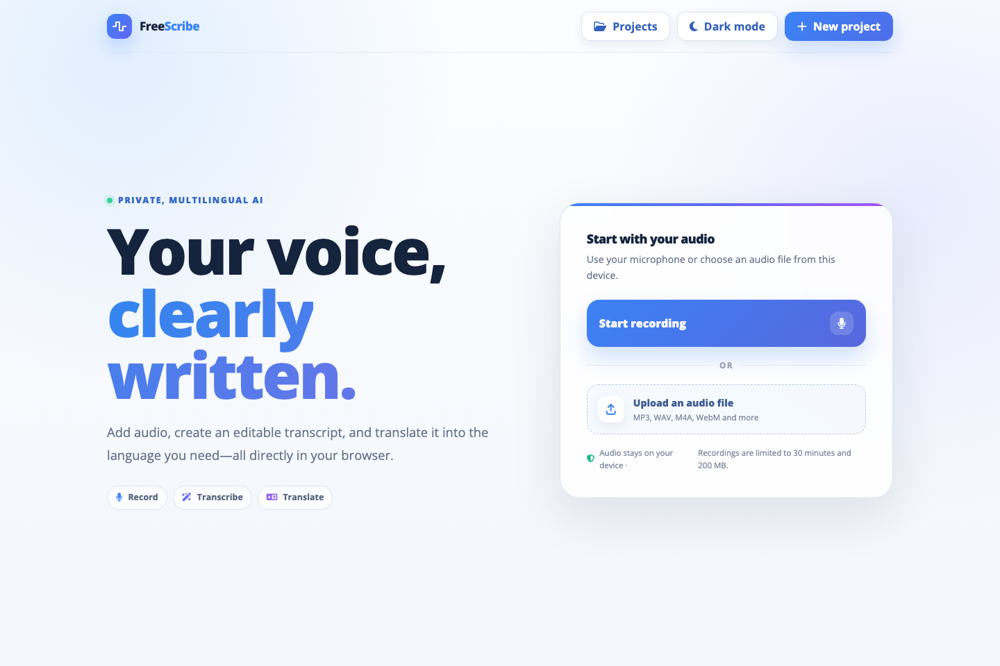

<div align="center">
  

  <h1>FreeScribe</h1>

  <p><strong>Your voice, clearly written.</strong></p>

  <p>Record or bring an audio file. Turn speech into editable text and subtitles, then translate it into another language—all in your browser.</p>

  <p><a href="#try-freescribe">Get started</a> · <a href="#the-mission">Explore the mission</a> · <a href="#build-it-with-us">Find your first contribution</a></p>
</div>

---

## The moment we are building for

Imagine a student replaying a lecture to catch one sentence. A volunteer trying to share a community meeting with neighbors who speak another language. A creator who wants captions so more people can follow their work.

Their words deserve to travel further than the recording. But turning audio into something people can read, edit, translate, and share is still too hard—and often means handing a recording to a service they did not choose.

**FreeScribe is an open-source attempt to change that.** It gives people a place to work with spoken words on their own device. The app uses AI to draft a transcript; a person remains in charge of checking and editing it.



## The mission

**Make spoken knowledge easier to understand, reuse, and share across languages, while giving people meaningful control over their recordings.**

We want a student to revisit a lesson, a community group to make a meeting more accessible, and a small creator to publish captions without needing specialist software or an account. We also want contributors to be able to inspect how the models work, measure their mistakes, and improve the experience in public.

This is a journey, not a finished promise. FreeScribe is currently an **alpha prototype**. The goal is dependable, accessible, multilingual transcription and translation whose strengths and limits are visible to its users.

## What you can do today

1. **Bring a voice in.** Record with your microphone or select an audio file.
2. **Make it readable.** Whisper drafts a timestamped transcript in a browser worker. Choose a spoken language yourself or use local automatic detection.
3. **Make it yours.** Review and edit segments, jump to parts of the audio, and optionally translate with NLLB.
4. **Take it with you.** Copy text, export TXT, SRT, VTT, or JSON, and save a project in this browser for later.

The app has no FreeScribe backend for audio processing. Model files download on first use, then transcription and translation run in your browser. Saved projects stay in that browser's local storage. Read the [privacy details](PRIVACY.md) before using sensitive audio: your browser, extensions, hosting provider, and any files you choose to export still matter.

## Try FreeScribe

You can run the current app locally with Node.js and npm:

```bash
git clone https://github.com/DineshDhanoki/FreeScribe.git
cd FreeScribe
npm ci
npm run dev
```

Open the local address printed by Vite. Choose **Start recording** or **Upload an audio file**, then follow the on-screen steps. The first model download can take time and use substantial bandwidth and memory; later runs may reuse the browser cache. For non-English speech, the multilingual Whisper Base model is the recommended starting point. If language detection is uncertain, select the language manually and retry.

There is no hosted public demo linked here yet. A short, consented sample recording is the safest way to explore the workflow. Please do not record another person's voice without their permission.

## What we are building next

FreeScribe's [roadmap](PRODUCT_ROADMAP.md) separates shipped work from planned work. The most valuable next step is **evidence**: public or consented multilingual test audio, translation quality reports, and real device performance measurements. We also want better long-recording support, recoverable model downloads, stronger accessibility, speaker labels, and eventually live transcription. These are open work, not current features.

Quality varies with language, accent, recording conditions, and device. Recordings are currently limited to **30 minutes and 200 MB**. FreeScribe should not be used as the sole record for clinical, legal, or other safety-critical decisions. Check the [language and model support matrix](LANGUAGE_SUPPORT.md) and [model card](MODEL_CARD.md) for specifics.

## Build it with us

You do not have to be an AI researcher to help. A careful bug report, a keyboard accessibility fix, a clearer error message, documentation, or a reproducible test can make the next person's experience better.

| If you enjoy… | A place to start |
| --- | --- |
| Explaining things clearly | Improve a confusing screen or the [documentation](CONTRIBUTING.md). |
| Making software usable for more people | Help with [accessibility](https://github.com/DineshDhanoki/FreeScribe/issues/18). |
| Privacy and trust | Help verify the [local processing path](https://github.com/DineshDhanoki/FreeScribe/issues/17). |
| AI and language quality | Explore [multilingual evaluation](https://github.com/DineshDhanoki/FreeScribe/issues/5) or [translation benchmarking](https://github.com/DineshDhanoki/FreeScribe/issues/6). |
| Browser performance | Measure [cold and warm runs on real devices](https://github.com/DineshDhanoki/FreeScribe/issues/11). |

Start with the [open issues](https://github.com/DineshDhanoki/FreeScribe/issues), or [open a discussion](https://github.com/DineshDhanoki/FreeScribe/discussions) if you are unsure where your idea fits. Before writing code, read [CONTRIBUTING.md](CONTRIBUTING.md) and add a short note to the issue you want to work on. We value small, reviewable pull requests with a clear user problem and a way to verify the result. Newcomers are welcome to ask for a smaller first step on any issue.

**A useful contribution can be one line that helps someone understand their own words.**

## For developers

```bash
npm test
npm run lint
npm run build
```

`npm run verify` runs the broader local checks, including synthetic transcription and translation evaluation fixtures. Those fixtures are useful for regressions but are **not proof of real-world accuracy**. See the [architecture](ARCHITECTURE.md), [performance notes](PERFORMANCE.md), and [roadmap](PRODUCT_ROADMAP.md) for the technical direction.

## Trust and stewardship

- Read [PRIVACY.md](PRIVACY.md) for the data flow and local storage behavior.
- Read [SECURITY.md](SECURITY.md) to report a vulnerability privately.
- Read the [code of conduct](CODE_OF_CONDUCT.md), [governance](GOVERNANCE.md), and [support guide](SUPPORT.md) for how we work together.
- FreeScribe's original source is [MIT-licensed](LICENSE). Downloaded Whisper and NLLB model files, and any contributed datasets, have their own licenses and restrictions.

Never commit real recordings, patient information, private transcripts, credentials, or model files.
